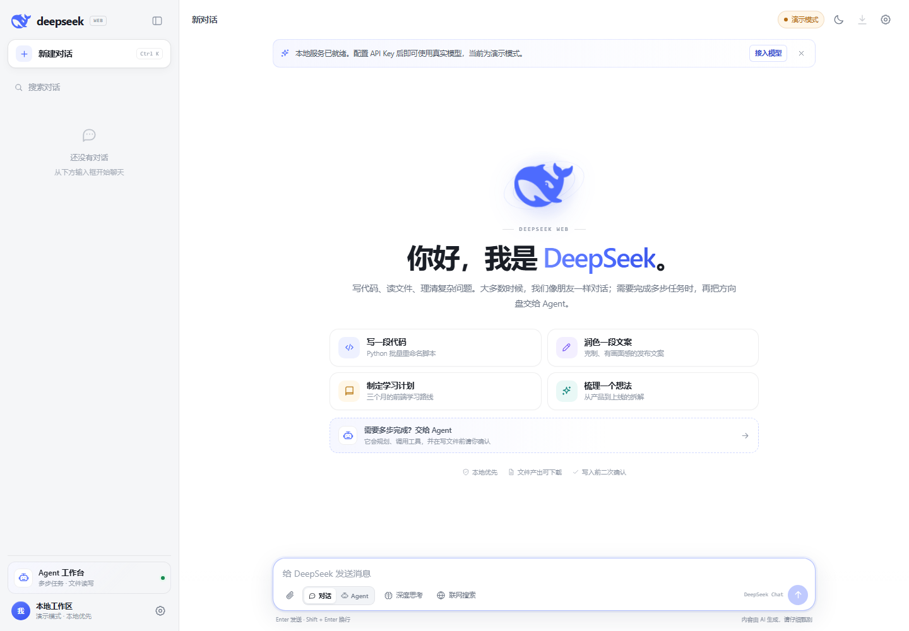
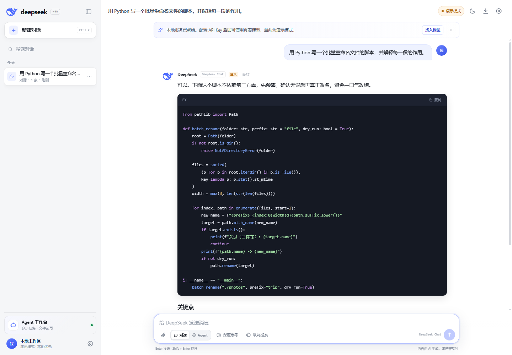
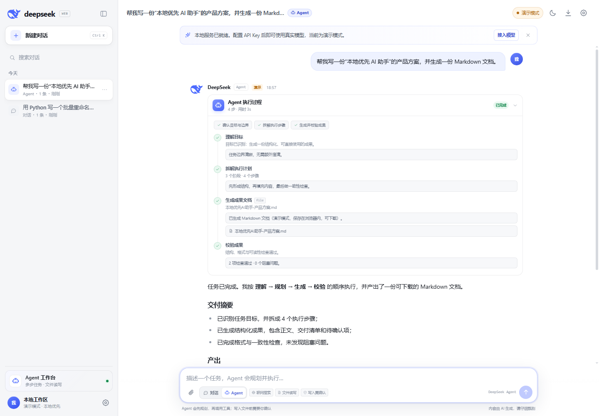

# DeepSeek Web

一个以**对话为主、Agent 为辅**的本地 DeepSeek 网页端。聊天和 Agent 是两个独立入口：日常问答用“新建对话”，多步任务用“新建 Agent 任务”。Agent 的写文件操作会先展示 diff，只有你确认后才会落盘，并保留 `.bak` 备份。

支持**自上传无限数量壁纸**、毛玻璃面板、壁纸/玻璃参数实时调节，以及可选的自动轮播。

> 这是一个本地优先的非官方界面，不是 DeepSeek 官方客户端。界面使用 DeepSeek 名称与鲸鱼标识用于展示目的。







## 功能

| 默认：对话 | 需要时：Agent |
| --- | --- |
| 流式回答、Markdown、代码高亮与复制 | 多轮工具循环，最多 15 轮 |
| 深度思考（`deepseek-reasoner`） | 联网搜索、读取/列出/写入文件、任务计划 |
| 联网搜索与引用来源 | 写文件前 diff 审批，可拒绝 |
| 历史记录、搜索、导出、主题、移动端 | 自动 `.bak` / `.bak.1` 备份，原子写入 |
| 无限壁纸、毛玻璃面板、参数调节 | 产出文件可下载 |

Agent 只在 Agent 入口创建的对话里启动，不会在普通聊天里擅自调用工具。

迭代优化：长回答的 Markdown 在 `markdown-worker.js` 中解析，不阻塞主线程；联网搜索结果带 5 分钟内存缓存；壁纸库按可视区域懒加载缩略图，启动时只加载当前壁纸原图。

## Windows EXE（推荐普通用户）

发布页：

**https://github.com/Apple-TWININGS/WEB-DEEPSEEK-with-Agent/releases/latest**

### 安装/使用

1. 从 Releases 下载 **`DeepSeek-Web.exe`**（约 88 MB）。
2. 放到一个你有写权限的文件夹，例如 `D:\Apps\DeepSeek-Web\`。
3. 双击运行。不需要安装 Node.js，也不需要管理员权限。
4. 程序会启动本地服务并自动打开：
   `http://127.0.0.1:4173`
5. 第一次运行会打开浏览器；如果没有自动打开，手动访问上面的地址。
6. 在页面右上角 **设置 → 模型服务** 填入 DeepSeek API Key，即可从演示模式切换到真实模型。

运行时会出现一个命令行窗口，**关闭窗口或按 Ctrl+C 就会停止本地服务**。这是正常行为，不是安装器残留。

## 手机 / 局域网访问

默认只监听 `127.0.0.1`，手机打不开。双击：

```text
start-lan.cmd
```

它会：

1. 把服务绑定到 `0.0.0.0:4173`；
2. 自动生成一个 10 位访问口令（也可以用 `ACCESS_PASSWORD` 固定）；
3. 在控制台打印手机地址、二维码和口令；
4. 在电脑上打开 `http://127.0.0.1:4173`。

手机和电脑连同一个 Wi-Fi，扫码打开地址，再输入控制台显示的口令即可。登录状态保持 7 天，重启服务后需要重新登录。

安全提醒：

- 这是局域网直连，没有云账号；只在可信 Wi-Fi 使用。
- 不要直接把 4173 端口映射到公网；外网访问请用 Tailscale/ZeroTier 或带认证的反向代理。
- `Origin: null`（file://、沙箱 iframe）和跨站 `Sec-Fetch-Site` 会直接拒绝；但同源校验不能替代访问口令。

### Windows SmartScreen

EXE 目前**没有代码签名**，Windows 可能显示“Windows 已保护你的电脑”：

```text
更多信息 → 仍要运行
```

如果你介意未签名程序，可以按下面的“从源码运行”方式使用。

### 数据目录

EXE 版本的数据不放在 EXE 旁边，而是：

```text
%LOCALAPPDATA%\DeepSeek Web\
  secrets.json          API Key
  agent-workspace\      Agent 可写工作区与产出文件
```

- 升级：关闭旧窗口，用新的 `DeepSeek-Web.exe` 覆盖旧文件即可，数据保留。
- 卸载：关闭窗口，删除 EXE；如不再需要数据，再手动删除 `%LOCALAPPDATA%\DeepSeek Web`。
- 想使用便携数据目录，可以在启动前设置：

```powershell
$env:DEEPSEEK_WEB_DATA = "D:\DeepSeekData"
.\DeepSeek-Web.exe
```

- 如果 4173 端口已被另一个实例占用，再启动 EXE 会直接打开已有页面。

### 校验下载

发布页同目录提供 `DeepSeek-Web.exe.sha256`。下载后可校验：

```powershell
Get-FileHash .\DeepSeek-Web.exe -Algorithm SHA256
```

## 从源码运行

需要 **Node.js 20+**，没有第三方运行时依赖。

```text
双击 start.cmd
```

或者：

```powershell
cd deepseek-web
node server.mjs
# 打开 http://127.0.0.1:4173
```

首次启动没有 API Key 时进入**演示模式**：回答由本地示例生成，不请求外部模型。点击右上角“演示模式”或设置图标，在“模型服务”里填入 Key 即可切换为真实模型。

Key 也可以由环境变量提供：

```powershell
$env:DEEPSEEK_API_KEY = "sk-..."
node server.mjs
```

### 配置项

| 环境变量 | 默认值 | 说明 |
| --- | --- | --- |
| `DEEPSEEK_API_KEY` | 空 | 优先生效；其次读取 `secrets.json` |
| `DEEPSEEK_BASE_URL` | `https://api.deepseek.com` | 可指向兼容 OpenAI Chat Completions 的服务 |
| `DEEPSEEK_MODEL` | `deepseek-chat` | 普通对话模型 |
| `DEEPSEEK_REASONER_MODEL` | `deepseek-reasoner` | 深度思考模型 |
| `DEEPSEEK_AGENT_MODEL` | `deepseek-chat` | Agent 工具循环模型 |
| `PORT` | `4173` | 本地端口 |
| `HOST` | `127.0.0.1` | 监听地址。改成 `0.0.0.0` 前请阅读安全说明 |
| `DEEPSEEK_WEB_DATA` | 源码目录 / EXE 的 `%LOCALAPPDATA%` | 数据目录覆盖 |
| `DEEPSEEK_WEB_OPEN_BROWSER` | EXE 为 `1` | 设为 `0` 可禁止自动打开浏览器 |
| `ACCESS_PASSWORD` | 局域网自动生成 | 自定义访问口令；留空则局域网模式随机生成 |
| `SEARCH_PROVIDER` | `auto` | `auto` / `searxng` / `serper` / `tavily` / `ddg` / `bing` |
| `SEARXNG_URL` | 空 | 自建 SearXNG 地址，例如 `http://127.0.0.1:8080` |
| `SERPER_API_KEY` | 空 | serper.dev 的 Google 搜索 API Key |
| `TAVILY_API_KEY` | 空 | Tavily Search API Key |

源码模式下，页面设置中的 Key 写入：

```text
deepseek-web/secrets.json
```

EXE 模式下写入：

```text
%LOCALAPPDATA%\DeepSeek Web\secrets.json
```

服务端只向页面返回配置状态、长度和掩码，不回发明文。读取优先级为：

```text
环境变量 DEEPSEEK_API_KEY  →  secrets.json
```

## 壁纸与玻璃面板

入口有两个：

- 顶部工具栏的**图片图标**；
- **设置 → 壁纸与玻璃**。

能力：

- 壁纸数量**不限**，单张最大 15 MB，支持 PNG / JPEG / WebP / GIF；
- 上传后点击缩略图切换，点击垃圾桶删除；
- 可调：壁纸浓度、模糊、明暗、缩放；
- 可调：玻璃面板模糊、不透明度；
- 可选自动轮播：30 秒 / 1 分钟 / 5 分钟；
- 一键关闭壁纸，保留所有已上传内容，下次可重新启用。

存储方式：

- 图片 Blob 存在浏览器 **IndexedDB**；
- 文件列表和参数存在 `localStorage`；
- 上传时生成小尺寸缩略图，并压缩到最长边 2560px 的 WebP/JPEG（GIF 保留原文件）；
- 设置里的缩略图按可视区域懒加载；
- 启动时只加载当前壁纸原图，切换时按需加载，不会一次性把所有大图读进内存；
- 设置里显示“已用 / 可用配额”，并在空间紧张时阻止继续添加；
- 不上传服务器。清除浏览器站点数据会同时删除壁纸。

## Agent 工作区与权限

**工作区**决定 Agent 能读写哪个目录，并且是**每个对话单独设置**的。

- 点击“新建 Agent 任务”时先选择工作区，再创建对话；
- 新对话默认定位到应用数据目录下的 `agent-workspace/`；
- 选择器可浏览服务器上的目录；工作区可以是已有代码库或文档目录，但 Agent 只能使用相对此目录的路径；
- 不允许选择应用数据目录或其上级目录，避免 Agent 读取 `secrets.json`；
- 每个 Agent 对话固定使用创建时选择的工作区，不会影响聊天或其他 Agent 对话。

**默认权限**：每次写文件前展示 unified diff，需要用户点击允许；修改已有文件自动保留 `.bak` / `.bak.1`。

**完全权限模式**：在 **设置 → Agent 权限** 或 Agent 工具栏的“逐次确认”按钮中开启。开启前必须勾选：

> 我已了解上述风险，并确认允许 Agent 在当前工作区自动写入文件。

开启后：

- 跳过逐次 diff 弹窗，直接写入当前工作区；
- 仍保留 `.bak` 备份，仍有文件大小/编码/JSON 校验；
- 60 分钟后自动失效；刷新页面、重启服务或切换对话也会失效；
- 只建议用于测试目录、临时目录或已有版本控制的项目。

## Agent 是怎么执行的

```text
用户任务
  ↓
系统提示 + 对话上下文 + 工具 schema
  ↓
流式模型调用（累积 tool_calls 参数）
  ↓
执行工具 ── web_search / read_file / list_files / write_file / task_plan
  ↓              │
  │              └─ write_file：生成 unified diff
  │                    ↓
  │                  SSE 推给前端，弹出确认框
  │                    ↓
  │              用户允许 → .bak 备份 → 原子写入 → 产出可下载文件
  │              用户拒绝 → 返回“未写入”给模型，继续调整
  ↓
最终回答 + 执行轨迹 + 来源 + 产出文件
```

安全边界：

- 文件工具只能访问 `agent-workspace/` 内的相对路径，拒绝 `..`、绝对路径和盘符；
- 只允许文本类扩展名；单次写入硬上限 2 MB，单文件上限 24 MB；
- 大文件支持 `read_file` 的 `offset/limit` 分块读取和 `write_file` 的 `append=true` 分块追加；
- `list_files` 默认递归三层，并支持 `path` 查看项目子目录，避免只看根目录就误判文件不存在；
- 写入后回读文件大小校验，不一致会报错，不会当作成功；
- Agent 输出上限提升到 8192 tokens，轮次预算 15 轮；多文件任务要求先用 `task_plan` 维护清单；
- `.json` 在写入前做语法检查；
- 不提供 shell 工具，不允许读取工作区外文件；
- 写文件不是模型直接完成的：服务端先发 diff，等待前端 `POST /api/agent/decision` 才执行；
- 修改已有文件时保留两代备份；写入采用临时文件 + rename；
- 工具轮次、单轮工具数量、重复调用都有上限；轮次用尽时会基于已有证据做收尾，并列出“未完成 / 需要确认”；
- 默认只绑定 `127.0.0.1`；`start-lan.cmd` 才绑定局域网，并自动启用访问口令；
- POST 请求校验同源、`Origin: null` 和 `Sec-Fetch-Site`。

## 项目结构

```text
deepseek-web/
  index.html            页面骨架、图标 sprite、设置与确认弹窗
  styles.css            主题、壁纸/玻璃、响应式布局、消息/Agent 轨迹/diff 样式
  markdown.js           无依赖 Markdown 渲染器（先转义，再格式化）
  markdown-worker.js    流式长文本的 Markdown Worker
  app.js                状态、渲染、聊天、Agent 事件、壁纸与审批流程
  server.mjs            静态服务 + DeepSeek 代理 + Agent 工具循环 + LAN 登录
  vendor/qrcode.cjs     二维码生成（qrcode-generator，MIT）
  packaging/
    sea-entry.cjs       EXE 启动入口（数据目录 + 内嵌资源）
  build-exe.cmd         双击构建 Windows EXE
  build-exe.ps1         实际构建脚本
  agent-workspace/      默认 Agent 工作区（创建 Agent 对话时选择）
  deepseek-icon.png     鲸鱼标识
  start.cmd             本机模式双击启动
  start-lan.cmd         局域网 + 访问口令 + 二维码启动
```

前端是原生 HTML/CSS/JS，没有前端构建步骤；`server.mjs` 只使用 Node 内置模块。

## 从源码打包 EXE

需要 Node.js 20+ 和 PowerShell。构建脚本会通过 `npx` 临时获取 `esbuild` 与 `postject`，不会把它们加入运行时依赖。

最简单的方式是双击：

```text
build-exe.cmd
```

或者在 PowerShell 中执行：

```powershell
cd deepseek-web
Set-ExecutionPolicy -Scope Process Bypass
.\build-exe.ps1
```

输出：

```text
dist\DeepSeek-Web.exe
dist\DeepSeek-Web.exe.sha256
```

说明：

- EXE 由一个 Node 单文件可执行程序（SEA）内嵌静态资源构建；
- 不包含 `secrets.json`，也不包含任何用户数据；
- 首次运行才在 `%LOCALAPPDATA%\DeepSeek Web` 创建数据目录；
- 生成的 EXE 未签名，Windows SmartScreen 可能提示；
- 重新构建后 SHA256 会变化。

## 接口

| 方法 | 路径 | 用途 |
| --- | --- | --- |
| `GET` | `/api/status` | 服务状态、Key 掩码、模型配置 |
| `POST` | `/api/key` | 保存/清除本机 Key |
| `POST` | `/api/test` | 测试模型接口连通性 |
| `POST` | `/api/chat` | SSE 流式聊天，可选服务端联网搜索 |
| `POST` | `/api/agent` | SSE Agent 执行流 |
| `POST` | `/api/agent/decision` | 批准/拒绝一次文件写入 |
| `GET` | `/api/files/<path>` | 下载 Agent 产物 |

## 参考与设计来源

Agent 的工程约束参考了本机的 **Professional Agent** 项目：

- 流式累积 `tool_calls`，参数不完整时不执行；
- 工具轮次上限、重复调用检测、轮次用尽后的证据收尾；
- 写入前 diff 审批、两代 `.bak` 备份、原子写入；
- Key 只落到 `secrets.json`，环境变量优先，只回传掩码；
- 外部能力失败时降级，而不是让整个页面不可用。

这个网页端把上述模式收在浏览器里，同时保留聊天作为默认、低摩擦的入口。

## 已知边界

- **单用户、本地优先**。没有账号系统；不要在不可信网络上用 `HOST=0.0.0.0` 暴露它。
- 浏览器 POST 会校验同源；`Origin: null`（file://、沙箱 iframe）和跨站 `Sec-Fetch-Site` 会被拒绝，但它们**不能替代**本地服务的访问控制。
- 联网搜索默认 DDG/Bing；国内网络建议配置 SearXNG 或 Serper/Tavily，否则搜索可能不可用。
- 每个对话会保持自己的模式：从 Agent 入口进入的对话做完任务后仍是 Agent，普通对话仍是聊天；新建对话默认聊天。
- 演示模式不会发起真实搜索，也不会写磁盘。
- 联网搜索使用 DuckDuckGo HTML，失败时回退 Bing RSS；搜索结果质量取决于上游服务。
- Agent 只处理文本文件，不执行命令，不处理二进制/图片。
- 浏览器 `localStorage` 存对话，容量有限；大量附件建议直接让 Agent 读工作区文件。
- 壁纸图片使用浏览器本地存储，清除站点数据会丢失；数量不限，但仍受浏览器存储配额限制。
- 没有实现多模型路由、云同步、团队协作。

## 检查

```powershell
node --check app.js
node --check markdown.js
node --check server.mjs
Invoke-RestMethod http://127.0.0.1:4173/api/status
```

更多界面截图在 [`screenshots/`](screenshots/)。
